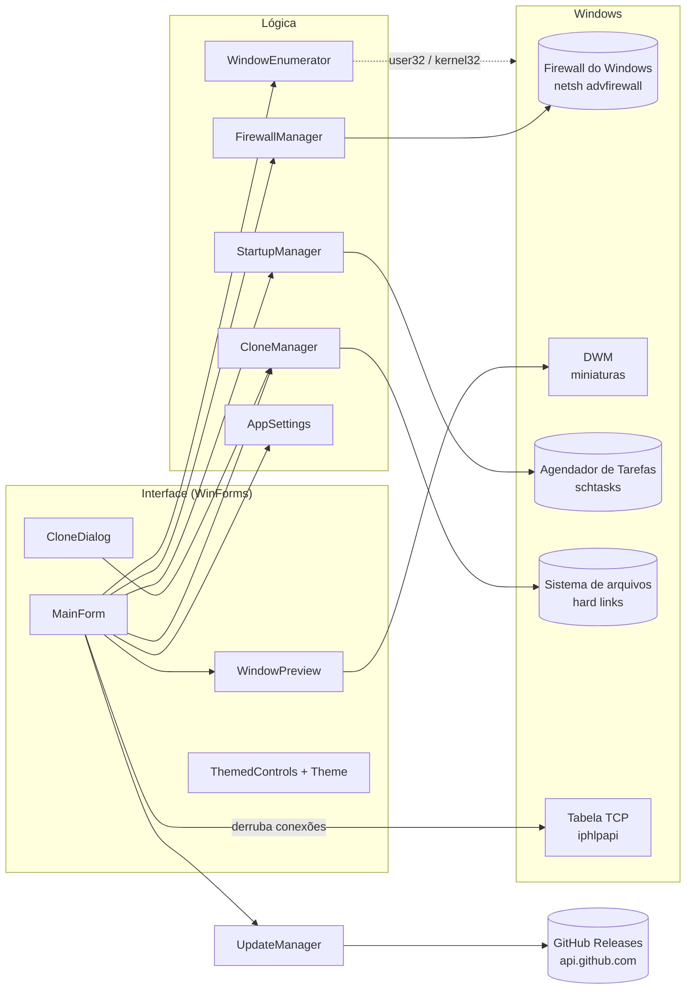
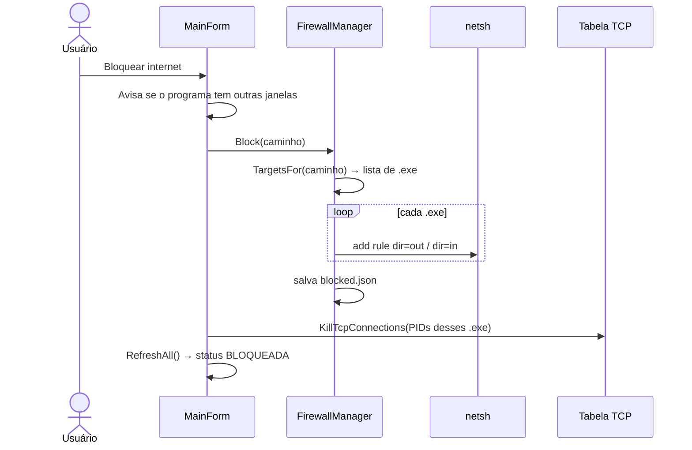
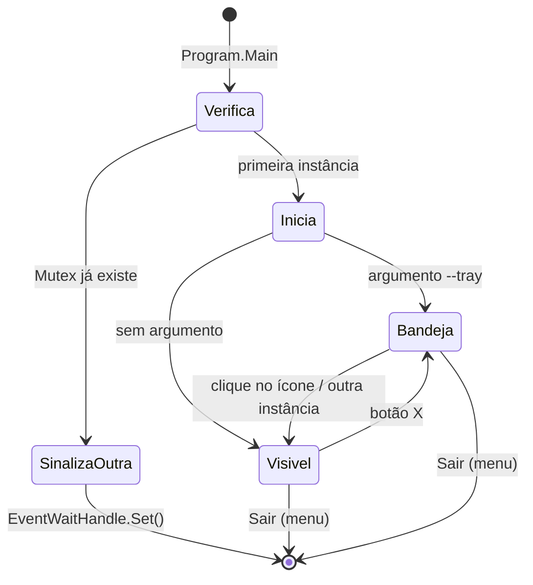
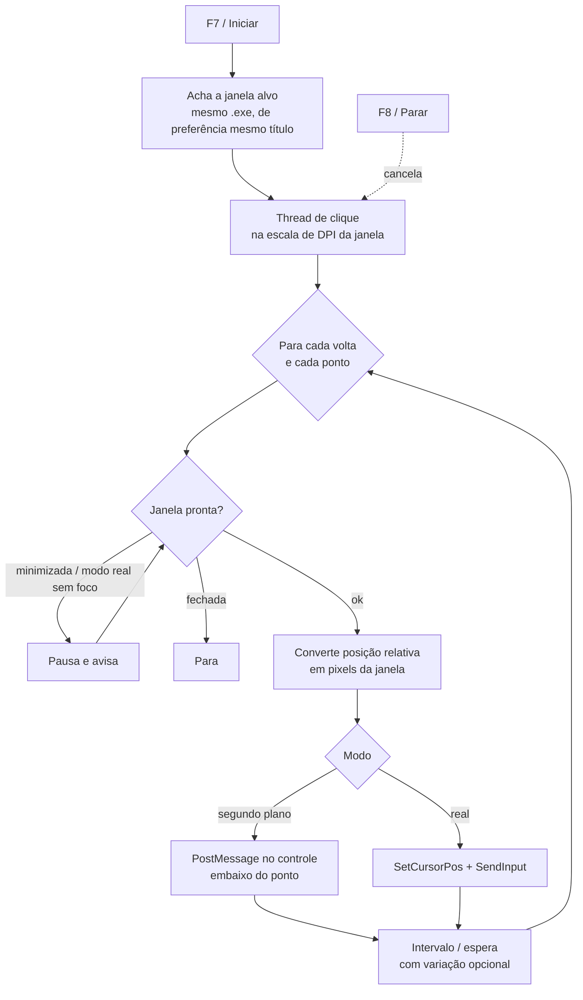
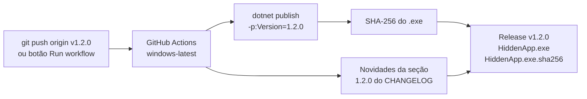
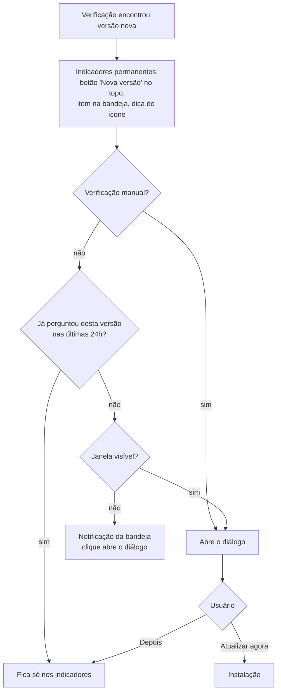
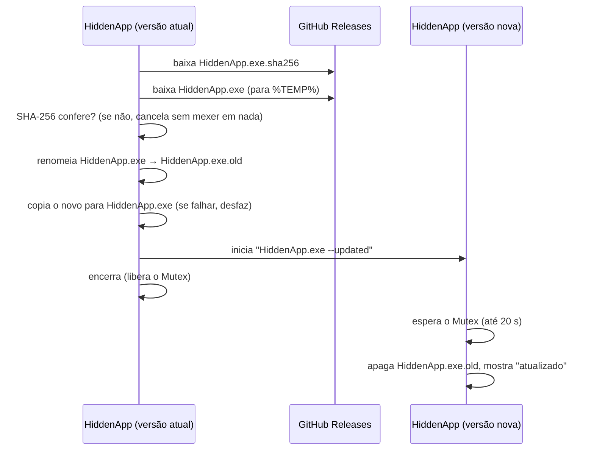

# Arquitetura do HiddenApp

Este documento explica **como** o HiddenApp funciona por dentro: quais APIs do Windows ele usa,
por que cada decisão foi tomada e como as partes se conectam. Para convenções de código e
armadilhas, veja [CLAUDE.md](CLAUDE.md). Para uso e compilação, veja o [README](README.md).

## Visão geral



O app é um único executável WinForms que roda **como administrador** (exigido pelo
`app.manifest`), porque criar regras de firewall e tarefas agendadas com privilégio máximo
exige elevação.

## 1. Listagem de janelas — `WindowEnumerator`

1. `EnumWindows` percorre todas as janelas de nível superior.
2. Mantém só as que apareceriam no **Alt+Tab**: visíveis, sem dono (`GW_OWNER`), sem o estilo
   `WS_EX_TOOLWINDOW` e não "ocultas" pelo DWM (`DWMWA_CLOAKED`, usado em apps suspensos do Windows 10/11).
3. Para cada janela, `GetWindowThreadProcessId` dá o **PID**, e `QueryFullProcessImageName`
   (com `PROCESS_QUERY_LIMITED_INFORMATION`) dá o **caminho do .exe**, funcionando até para processos elevados.
4. **Apps da Microsoft Store:** a janela pertence ao `ApplicationFrameHost.exe`; o processo real é o
   de uma janela filha com outro PID, encontrado via `EnumChildWindows`.

Se o caminho não puder ser lido (processo protegido do sistema), a janela aparece como **SEM ACESSO**.

## 2. Bloqueio de internet — `FirewallManager`

### Por que firewall por caminho do .exe

O Windows associa tráfego de rede a **processos/executáveis**, não a janelas. O Firewall do Windows
filtra por **caminho do programa** (não aceita PID). Por isso o bloqueio é sempre do programa inteiro.

### Como as regras são criadas

Para cada executável alvo, são criadas duas regras com o mesmo nome:

```
netsh advfirewall firewall add rule name="HiddenApp - <caminho>" dir=out action=block program="<caminho>" enable=yes profile=any
netsh advfirewall firewall add rule name="HiddenApp - <caminho>" dir=in  action=block program="<caminho>" enable=yes profile=any
```

- **Remover:** `delete rule name="HiddenApp - <caminho>"` apaga as duas de uma vez.
- **Conferir se existe:** `show rule name=...` → código de saída `0` = existe.
- A saída do `netsh` vem no idioma do Windows, então só o **código de saída** é usado.

### Estado salvo

A lista de programas bloqueados fica em `%AppData%\HiddenApp\blocked.json`. Ao abrir, cada item é
**conferido no firewall**; se alguém apagou a regra manualmente, o item sai da lista.
As regras continuam valendo com o app fechado e após reiniciar o PC.

### Conexões que já estavam abertas

Uma regra nova impede conexões **novas**, mas conexões TCP já estabelecidas podem continuar.
Logo após bloquear, o app chama `GetExtendedTcpTable` (TCP IPv4 com PID dono) e, para cada
conexão dos processos afetados, `SetTcpEntry` com estado `DELETE_TCB`, o que derruba a conexão.
Limitação: não existe equivalente para IPv6 ou UDP.



## 3. Cópia bloqueável — `CloneManager`

### O problema

Como o firewall só distingue **caminhos**, duas janelas do mesmo `chrome.exe` não podem ter
bloqueios diferentes.

### A solução: o mesmo programa em outro caminho

1. Calcula a pasta da cópia: `X:\HiddenAppClones\<Nome>_<hash>[_N]\`, onde `X:` é **o mesmo disco**
   do original (hard links não atravessam volumes), `<hash>` são 8 caracteres do SHA-1 do caminho
   da pasta original e `_N` é o número da cópia (a cópia 1 não tem sufixo). Assim um programa pode ter
   **várias cópias**, cada uma com caminho próprio — e portanto bloqueio próprio no firewall.
2. Recria a árvore de pastas e, para cada arquivo, chama `CreateHardLink`.
   - Hard link = **outro nome para o mesmo arquivo** no disco: criação instantânea, **zero espaço extra**.
   - Se o link falhar (permissão), copia o arquivo de verdade.
   - Pastas que são atalhos (junction/symlink) são ignoradas para evitar loops.
3. Se a cópia já existe, só refaz os links de arquivos que mudaram (tamanho/data diferentes),
   o que acontece quando o programa original é atualizado.
4. Bloqueia a cópia (opcional, marcado por padrão) **antes** de abri-la, para ela nunca conectar.
5. Abre o `.exe` da cópia **sem elevação** (ver abaixo).
6. Após 4 segundos, verifica se algum processo da cópia ainda está rodando. Se não, o programa
   provavelmente é de **instância única** e repassou a janela para o original, e o usuário é avisado.

### Nome e argumentos de cada cópia

Cada pasta de cópia guarda um `_HiddenApp.json` com o **nome** dado pelo usuário (ex.: "Trabalho";
sem nome, aparece "Cópia N") e os **argumentos** usados para abri-la. Os argumentos são reutilizados
quando a cópia é aberta de novo pelos favoritos, para manter o mesmo perfil separado.

### Bloqueio de todos os executáveis da cópia

Muitos programas usam um **launcher** que inicia outro `.exe` (ex.: Discord). Por isso, quando o alvo
é uma cópia, `FirewallManager.TargetsFor` retorna **todos os `.exe` da pasta da cópia**, e o status
"BLOQUEADA" vale para qualquer janela vinda dela.

### Programas de instância única

Navegadores verificam se já há uma instância usando a mesma pasta de perfil e, se houver, só pedem
para ela abrir uma janela. Para evitar isso, o diálogo sugere um perfil separado dentro da cópia:

| Programa | Argumento sugerido |
|---|---|
| Chrome, Edge, Brave, Vivaldi, Opera | `--user-data-dir="<cópia>\_HiddenAppData"` (um perfil por cópia) |
| Firefox | `-no-remote -profile "<cópia>\_HiddenAppData"` |

### Abrir sem privilégio de administrador

Como o HiddenApp é elevado, um `Process.Start` comum criaria a cópia **também como administrador**
(o que causa avisos e problemas em navegadores). `Native.StartUnelevated` faz:

1. `GetShellWindow` → janela do Explorer → PID do Explorer (que roda como usuário comum);
2. `OpenProcessToken` + `DuplicateTokenEx` → token primário não elevado;
3. `CreateProcessWithTokenW` com esse token.

Se falhar, usa `Process.Start` como plano B.

### Apagar cópias

`DeleteAllClones` percorre `HiddenAppClones` em todos os discos fixos, **pula pastas com processos
rodando** e apaga o resto. Apagar um hard link não afeta o arquivo original. As regras de firewall
das cópias são removidas **antes** (para conseguir listar os `.exe`), e as cópias que não puderam
ser apagadas são bloqueadas de novo.

## 4. Prévia ao vivo — `WindowPreview`

Usa a mesma API das prévias do Alt+Tab e da barra de tarefas:

1. `DwmRegisterThumbnail(form, janelaOrigem)` cria a miniatura;
2. `DwmQueryThumbnailSourceSize` dá o tamanho original, para manter a proporção;
3. `DwmUpdateThumbnailProperties` define o retângulo de destino.

O DWM desenha a miniatura **em coordenadas do Form** (não do painel), então o painel converte sua
posição e reajusta a cada 200 ms (redimensionamento, janela minimizada ou fechada).
Janela minimizada não tem conteúdo para mostrar, então o painel exibe um aviso.

## 5. Bandeja e ciclo de vida — `Program` + `MainForm`



- **Instância única:** `Mutex("HiddenApp_SingleInstance")`. Uma segunda execução sinaliza o evento
  `HiddenApp_ShowWindow` e encerra; a primeira (que espera o evento numa thread) mostra a janela.
- **Começar escondido:** `SetVisibleCore` é sobrescrito; enquanto `_allowShow` for falso, a janela
  não aparece, mas o handle é criado (necessário para a prévia e para receber `BeginInvoke`).
- **Fechar no X** cancela o fechamento e esconde; na primeira vez mostra um balão explicando.
- **Menu da bandeja** é reconstruído a cada abertura (lista atual de bloqueados).

## 6. Iniciar com o Windows — `StartupManager`

A chave `HKCU\...\Run` **não funciona** para apps `requireAdministrator`: o Windows simplesmente
não os inicia no logon. A solução é uma **Tarefa Agendada**:

- gatilho: **logon do usuário atual**, com 5 s de atraso;
- `RunLevel = HighestAvailable` → roda elevado **sem prompt do UAC**;
- `LogonType = InteractiveToken` → aparece na sessão do usuário (necessário para a bandeja);
- não para na bateria e sem limite de tempo de execução;
- ação: `HiddenApp.exe --tray`.

A tarefa é criada com `schtasks /Create /XML` (o XML permite configurar bateria e limite de tempo,
o que os parâmetros simples do `schtasks` não permitem). Ao abrir, `RefreshIfEnabled` recria a
tarefa para garantir que aponta para o `.exe` atual.

## 7. Interface e temas — `Theme` + `ThemedControls`

- **Paletas** (`Palette`): escura (padrão) e clara, com cores tiradas do ícone (azul-marinho,
  ciano e vermelho). `Theme.Set()` troca a paleta e dispara `Theme.Changed`; o `MainForm` reaplica
  as cores e repinta tudo.
- **Controles próprios** desenhados em `OnPaint`: `RoundButton` (Primary/Secondary/Danger),
  `Card` (painel arredondado com título), `ToggleSwitch` e `ThemedListView` (owner-draw, linhas mais
  altas, etiquetas coloridas).
- **Integração com o Windows:**
  - barra de título escura (`DWMWA_USE_IMMERSIVE_DARK_MODE`) e, no Windows 11, na cor do tema
    (`DWMWA_CAPTION_COLOR` / `DWMWA_TEXT_COLOR`);
  - barras de rolagem escuras com `SetWindowTheme(..., "DarkMode_Explorer")`;
  - menu da bandeja com `ToolStripProfessionalRenderer` personalizado.
- **Escala de tela:** o app é `SystemAware`; `Theme.Dpi` é lido uma vez e `Theme.S(px)` converte
  medidas pensadas para 100% de zoom.
- **Recursos:** `HiddenApp.ico` e `logo.png` são embutidos no executável (`EmbeddedResource` com
  `LogicalName`) e o `.ico` também é o ícone do `.exe` (`ApplicationIcon`).

## 8. Favoritos e balões de ajuda

- **Favoritos** são caminhos de `.exe` (originais ou cópias) guardados em `settings.json`. A lista mostra
  o nome amigável (descrição do executável, ex.: "Google Chrome", + nome da cópia) e a situação
  (`SEM INTERNET` / `COM INTERNET` / `NÃO ENCONTRADO`). Bloquear um favorito funciona mesmo com o programa
  fechado, porque a regra de firewall é por caminho. "Abrir" inicia o programa sem elevação e, para
  cópias, com os argumentos salvos.
- Na lista de janelas, a primeira coluna tem uma **estrela** (amarela = favorito, cinza = não) desenhada
  como polígono (`Gfx.FillStar`); clicar nela adiciona ou remove o programa dos favoritos.
- Os cartões de Favoritos (borda amarela) e Programas bloqueados (borda vermelha) usam `Card.Accent`.
- O ícone da bandeja tem um submenu **Favoritos** com bloquear/liberar/abrir para cada um.
- **Balões de ajuda** (`ThemedToolTip`): tooltip desenhado à mão (título em ciano + explicação) com as
  cores do tema, ligado a cada botão por `_tips.Set(...)`.

### Doações (Pix)

`Donation` monta o **BR Code** estático (padrão EMV do Banco Central): conta Pix com a chave aleatória,
moeda 986 (real), país BR, nome e cidade do recebedor, identificador `***` (valor livre) e o CRC16-CCITT
no final. O QR é gerado em tempo de execução com a biblioteca **QRCoder** (MIT), sempre preto no branco.
Nada é baixado: a chave só muda numa versão nova, que passa pelo GitHub oficial e pela verificação SHA-256.
A janela de doação mostra o nome completo do recebedor para quem doa conferir no app do banco — a defesa
contra cópias falsas do programa com outra chave.

## 9. Auto clique — `AutoClickPage` + `ClickRunner` + `Macro`

### Modelo

Uma **macro** tem a janela alvo (caminho do `.exe` + título, para reencontrá-la), o **modo**, quantas voltas
(0 = sem parar), a variação aleatória dos tempos e a lista de **pontos**. Cada ponto guarda a posição
**relativa** (0 a 1) à área interna da janela, o botão, a ação (clique, duplo, segurar + tempo), quantos
cliques seguidos, o intervalo e a espera antes do próximo. Tudo fica em `%AppData%\HiddenApp\macros.json`.

### Execução



- **Segundo plano:** desce até o controle filho exato embaixo do ponto (`ChildWindowFromPointEx`) e envia
  `WM_MOUSEMOVE` + `WM_xBUTTONDOWN/UP` (e `DBLCLK` no clique duplo). Não usa o mouse do usuário, mas muitos
  jogos e alguns apps ignoram mensagens que não vêm do hardware.
- **Real:** move o cursor e usa `SendInput`. Só clica quando a janela alvo está em primeiro plano; se o usuário
  trocar de janela, a macro pausa até a janela voltar para a frente.
- **Segundo plano (alternativo):** envia `WM_ACTIVATE` e `WM_SETCURSOR` e depois o clique com `SendMessageTimeout`
  na janela principal (sem descer aos controles filhos), para programas que só aceitam clique quando "acham" que
  estão ativos.
- **Real com retorno:** guarda a janela em primeiro plano e a posição do cursor, traz a janela alvo para a frente
  (`AttachThreadInput` + `SetForegroundWindow`, porque o Windows bloqueia a troca de foco vinda de segundo plano),
  clica com `SendInput` e devolve o cursor e a janela anterior — sempre, mesmo se a macro for parada.
- **Segurar:** aperta, espera o tempo e solta — o soltar fica num `finally`, então o botão nunca fica preso.
- **DPI:** a thread adota o contexto de DPI da janela alvo (`SetThreadDpiAwarenessContext` com
  `GetWindowDpiAwarenessContext`), para que posições de mouse e da janela usem as mesmas coordenadas que ela.

### Marcar pontos

- **Pela prévia:** a prévia do auto clique mostra só a área interna da janela (`fSourceClientAreaOnly`); o clique
  na miniatura vira uma posição relativa (0–1) diretamente.
- **Pela tecla de captura (F9):** lê a posição do mouse, descobre a janela embaixo dele (`WindowFromPoint` +
  `GetAncestor`) e converte para posição relativa na área interna. Se a macro ainda não tem alvo, essa janela vira o alvo.

### Compartilhar macros

Exportar grava um `.hiddenmacro` (JSON com `Formato`, `Versao` e a lista de macros). Importar confere o formato,
recusa versões mais novas, dá um Id novo a cada macro e corrige valores fora dos limites (posições fora de 0–1,
tempos negativos, quantidades absurdas). Como o programa alvo pode estar em outra pasta no PC de quem importa,
a busca da janela também aceita o mesmo **nome de .exe** em qualquer caminho.

### Teclas de atalho

`RegisterHotKey` no handle da janela principal, com `MOD_NOREPEAT`. As mensagens `WM_HOTKEY` chegam mesmo com
o app escondido na bandeja. As teclas são configuráveis (`HotkeyDialog`) e salvas em `settings.json`.

## 10. Atualização automática — `UpdateManager` + `UpdateDialog`

### Versionamento

Versões seguem **SemVer** (`1.2.3`, betas com sufixo: `1.2.3-beta.1`). A versão do app em execução
vem do `AssemblyInformationalVersion` (o `<Version>` do projeto). A comparação segue as regras do
SemVer: `1.1.0-beta.2 < 1.1.0-beta.11 < 1.1.0-rc.1 < 1.1.0`.

### Publicação (GitHub Actions)



Tags com sufixo (`v1.2.0-beta.1`) viram **pré-lançamento** (beta).

### Verificação

- Ao abrir (8 s depois, para não atrasar) e a cada **6 horas**.
- Só versões estáveis: `GET /repos/{dono}/{repo}/releases/latest` (o GitHub já ignora betas e rascunhos;
  `404` = nenhuma versão publicada).
- Com "Receber versões beta": `GET /releases?per_page=30` e escolhe a maior versão.
- Só considera releases que têm o asset `HiddenApp.exe`. Sem login: limite de 60 consultas/hora por rede.
- Falhas (sem internet, GitHub fora do ar) são silenciosas na verificação automática.

### Quando perguntar



### Instalação



- O Windows não permite **sobrescrever** um `.exe` em execução, mas permite **renomeá-lo**.
- O caminho do executável não muda: regras de firewall, tarefa de "Iniciar com o Windows" e
  configurações continuam válidas.
- O app roda como administrador, então a versão nova também abre elevada (sem novo prompt).
- O arquivo é baixado pelo próprio app (sem a "marca da web"), por isso o SmartScreen normalmente
  não reaparece a cada atualização.
- Rodando pelo Visual Studio (`HiddenApp.dll` ao lado do `.exe`), a troca é desativada e o diálogo
  oferece só abrir a página da versão.

### Segurança

A integridade vem de: download só por **HTTPS**, só do repositório configurado em `UpdateManager`,
e **SHA-256** gerado pelo próprio workflow. Quem controla a conta do GitHub controla as atualizações,
por isso a conta deve ter **autenticação em dois fatores**. Assinar o executável com certificado de
código seria a próxima camada de proteção.

## 11. Publicação

O perfil `Properties/PublishProfiles/Portatil.pubxml` gera um **único `HiddenApp.exe`** para
`win-x64`, **autocontido** (inclui o runtime do .NET), com compressão e sem arquivos de debug.
WinForms não suporta *trimming*, por isso o executável tem cerca de 50 MB.
O ícone e o manifesto de administrador ficam embutidos no `.exe` final.

## Mapa das APIs do Windows usadas

| Área | API | Biblioteca |
|---|---|---|
| Janelas | `EnumWindows`, `EnumChildWindows`, `GetWindowText`, `GetWindowThreadProcessId`, `GetForegroundWindow`, `IsIconic` | user32 |
| Janelas ocultas / prévia | `DwmGetWindowAttribute`, `DwmRegisterThumbnail`, `DwmUpdateThumbnailProperties` | dwmapi |
| Tema | `DwmSetWindowAttribute`, `SetWindowTheme` | dwmapi, uxtheme |
| Processos | `OpenProcess`, `QueryFullProcessImageName` | kernel32 |
| Hard links | `CreateHardLink` | kernel32 |
| Abrir sem elevação | `GetShellWindow`, `OpenProcessToken`, `DuplicateTokenEx`, `CreateProcessWithTokenW` | user32, advapi32 |
| Conexões TCP | `GetExtendedTcpTable`, `SetTcpEntry` | iphlpapi |
| Firewall | `netsh advfirewall firewall` | (processo externo) |
| Inicialização | `schtasks /Create /XML` | (processo externo) |
| Auto clique | `SendInput`, `SetCursorPos`, `PostMessage`, `ChildWindowFromPointEx`, `ClientToScreen`, `ScreenToClient`, `WindowFromPoint`, `SetThreadDpiAwarenessContext`, `RegisterHotKey` | user32 |
| Atualizações | GitHub REST API (`/releases`, `/releases/latest`) | `HttpClient` |
